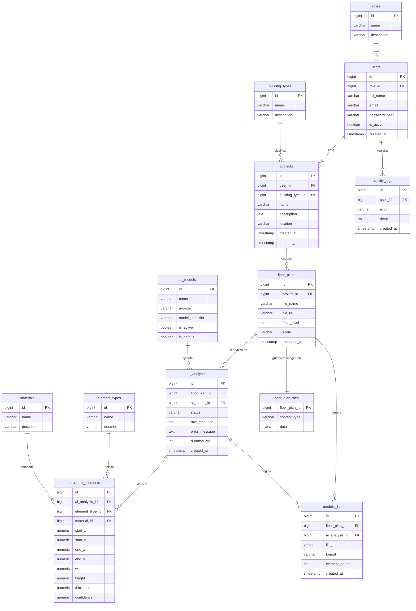

# Render.IA — Base de datos

Base de datos de **Render.IA**, una plataforma que usa inteligencia artificial para convertir planos 2D en modelos estructurales 3D.

- **Motor:** PostgreSQL (Neon, región Oregon)
- **Tablas:** 13 (nombres en inglés, datos en español)
- **Integrantes:** Juan David Moreno, Felipe Cerón

## Archivos

| Archivo | Contenido |
|---|---|
| `schema.sql` | Creación de las 12 tablas |
| `seed.sql` | Datos iniciales de roles y catálogos |
| `migrations/` | Cambios aplicados después de la primera versión, en orden |

## Diagrama entidad-relación

